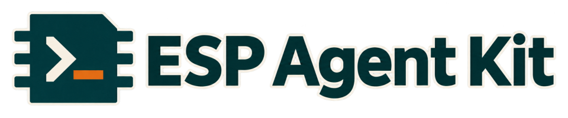
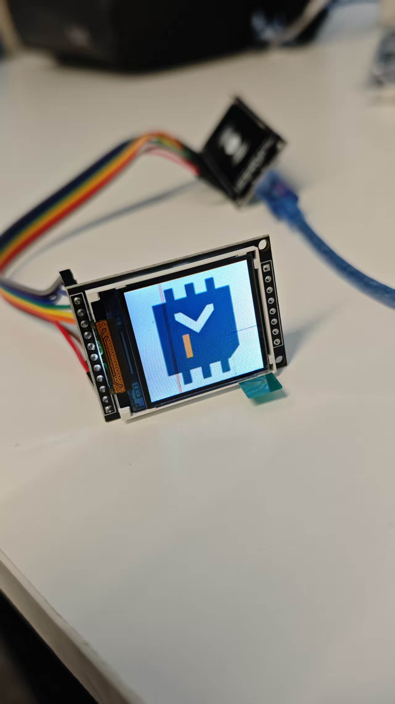
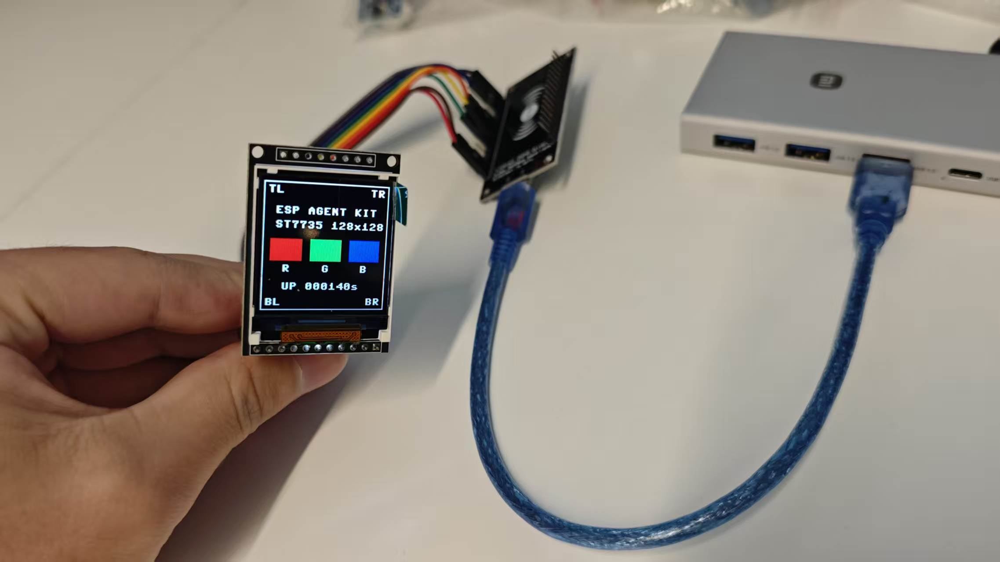

<h1 align="center"></h1>

<p align="center">English · <a href="README.zh-CN.md">简体中文</a></p>

<p align="center"><strong>Program your hardware through conversation.</strong></p>

<p align="center">
  <a href="LICENSE"></a>
</p>

ESP Agent Kit gives your desktop AI agent the tools and guidance to identify devices, prepare the development environment, write and deploy programs, and debug real hardware. Describe what you want, follow the wiring guidance, and try the device. Your agent handles code and tool commands while you give feedback.

The project is designed to bring one workflow to Windows, macOS, Linux, and agents such as Codex, Claude Code, and WorkBuddy that can read local files and run commands. Development currently focuses on supported ESP boards running MicroPython, with more hardware backends planned.

[Get started](#get-started) · [Current support](#current-support) · [Roadmap](#roadmap)

<p align="center">
  
  
</p>

## How it works

Connect your hardware, describe a goal, and refine the behavior as you try it. For example, requests during a project might look like this:

> “Turn on the light when someone approaches.”
>
> “It switches off as soon as I leave. Keep it on for another ten seconds.”
>
> “That works the way I want. Save this version.”

Your agent checks the hardware and wiring, writes the application, and deploys changes. You operate the device and describe what happens. The agent uses your observations and device feedback to adjust the program. Once you confirm the behavior, it saves the source and project records for the next change.

## Features

| Capability | What it means for you |
| --- | --- |
| **Conversation-driven programming** | Describe the behavior and changes you want. Your agent handles the code and underlying tools. |
| **Guidance from the first connection** | Ask your agent to prepare the environment, identify the connected device, and guide you through wiring and initial setup. |
| **Use your own agent** | The repository's `AGENTS.md`, bundled Skill, and local CLI provide a common workflow for agents with file access and local command execution. |
| **Development and debugging together** | Run probes, inspect exceptions, deploy updates, and recover from failures through the same workflow. |
| **Standalone devices** | The installed application starts on power-up and runs without your development computer or agent session. |
| **Projects you can keep working on** | Keep source, dependencies, wiring, deployment snapshots, and confirmed observations locally for later changes or handoff. |

## Get started

Use the cloned `esp-agentkit` directory as your agent's workspace. The root [AGENTS.md](AGENTS.md) guides it to the bundled [Skill](skill/esp-agentkit/SKILL.md) throughout development. Your agent needs local file access and permission to run commands.

### 1. Clone and open the workspace

With Git installed, run:

```sh
git clone https://github.com/xucailiang/esp-agentkit.git
cd esp-agentkit
```

Open this `esp-agentkit` directory in your agent. New device projects belong in `device-projects/<project-name>/`, with their source, wiring notes, configuration, and development records kept together. This directory is ignored by the repository's Git configuration; keep a separate backup when preserving or moving your projects.

### 2. Connect your board and describe your goal

Connect a board with a USB data cable and give your agent this prompt:

```text
Please read AGENTS.md and follow its guidance to help me build: [describe the behavior].
```

Share a model name, wiring description, or photo if needed and supported by your agent. Follow its guidance for initial setup and deployment, then try the device and describe any changes you want. Before delivery, power the device independently and confirm its behavior.

Your agent uses the detailed instructions for [device detection](skill/esp-agentkit/SKILL.md#detect-a-connected-device), [firmware installation](skill/esp-agentkit/SKILL.md#install-the-firmware-on-a-new-board), [initial configuration](skill/esp-agentkit/SKILL.md#configure-and-verify), and [application deployment](skill/esp-agentkit/SKILL.md#deploy-an-application). You can ask it to explain the implementation or work with the code directly at any time.

### 3. Prepare the environment yourself (optional)

Your agent can handle environment preparation. To do it yourself, install uv if needed using the appropriate command from the [uv installation guide](https://docs.astral.sh/uv/getting-started/installation/):

**macOS / Linux**

```sh
curl -LsSf https://astral.sh/uv/install.sh | sh
```

**Windows PowerShell**

```powershell
powershell -ExecutionPolicy ByPass -c "irm https://astral.sh/uv/install.ps1 | iex"
```

Reopen your terminal after installation, return to the cloned `esp-agentkit` root directory, and run these cross-platform commands:

```sh
uv sync --project skill/esp-agentkit --locked
uv run --project skill/esp-agentkit --locked python --version
uv run --project skill/esp-agentkit --locked python skill/esp-agentkit/scripts/agentkit.py --help
```

uv selects Python 3.12 using the Skill's `.python-version`, creates `skill/esp-agentkit/.venv`, and installs the dependencies declared in [pyproject.toml](skill/esp-agentkit/pyproject.toml) at the versions recorded in [uv.lock](skill/esp-agentkit/uv.lock). `uv run` uses this environment without manual activation and keeps the repository root as the working directory. Expect Python `3.12.x` and the CLI help text; these checks do not connect to a device.

## Current support

The project is in active development. The current implementation and recorded hardware coverage are:

| Area | Current scope |
| --- | --- |
| Development path | Matching official MicroPython v1.29.0 firmware, initial setup over USB, then WebREPL debugging and application updates on a trusted 2.4 GHz Wi-Fi LAN. |
| Desktop tools | Python 3.12 managed with uv. The Skill includes environment setup instructions and a local CLI. |
| Chip detection | USB serial discovery and esptool identification for Espressif chips supported by the installed esptool version. Chip detection does not establish the carrier board's pinout or provisioning and deployment compatibility. |
| Board profiles | [NodeMCU V3 / ESP-12F](skill/esp-agentkit/boards/esp8266-esp-12f.md) and [ESP32-DevKitC V4 / ESP32-WROOM-32E](skill/esp-agentkit/boards/esp32-devkitc-v4.md). Each profile documents its firmware and wiring requirements. |
| Agent interface | Local file access and command execution are required. Agents read the root `AGENTS.md`, follow the bundled Skill's instructions, and call its CLI from the repository workspace. |

Recorded board trials use a NodeMCU V3 / ESP-12F with its onboard LED and a MAR1441 SPI display. They include wireless deployment, LED startup on independent power, and a display image update completed by Claude Code after a handoff from Codex in the same workspace. Board profiles and the cross-platform design do not imply that every board, operating system, and agent combination has been verified. See [hardware validation progress (Chinese)](docs/architecture-and-development.md#分阶段开发与验收) for recorded results and remaining checks.

WebREPL uses unencrypted connections and shares the application's interpreter; diagnostic commands can interrupt the running program. The Skill guides the agent through observation and recovery for this workflow.

## Roadmap

These are development priorities, with hardware adaptation and community contributions able to progress in parallel:

1. **Complete the ESP onboarding flow.** Bring environment preparation, device detection, setup, wiring guidance, and first deployment into a consistent experience across desktop platforms and agents.
2. **Integrate the full debugging workflow.** Connect serial output, REPL access, logs, probes, peripheral checks, recovery, and session continuity.
3. **Add native programming and debugging.** Integrate toolchains, firmware builds, flashing, and hardware-supported breakpoints and variable inspection.
4. **Support more hardware families.** Add detection, programming, observation, and recovery backends for other MCUs and Linux devices.
5. **Grow reusable integrations and projects.** Make it easier to contribute backends, board profiles, drivers, application templates, wiring examples, and troubleshooting guidance.

See the [project direction and full roadmap (Chinese)](docs/project-positioning-and-roadmap.md). Planned capabilities are separate from current support.

## Documentation and contributing

- [Skill and CLI guide](skill/esp-agentkit/SKILL.md) — setup, project operations, debugging, deployment, and recovery.
- [Board profiles](skill/esp-agentkit/boards/) — firmware, pins, and board-specific requirements.
- [Architecture and implementation progress (Chinese)](docs/architecture-and-development.md) — current design and hardware records.
- [Project guidelines (Chinese)](AGENTS.md) and [local regression checks](tests/README.md) — guidance for contributors.

Contributions to hardware support, drivers, documentation, and failure recovery are welcome. When [reporting an issue](https://github.com/xucailiang/esp-agentkit/issues), include the board, firmware, host operating system, steps, and observed behavior. Remove credentials from logs before sharing them.

[MIT License](LICENSE) · [Third-party licenses](docs/third-party.md)
