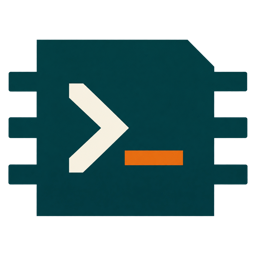

<h1> ESP Agent Kit</h1>

English · [简体中文](README.zh-CN.md)

Build MicroPython applications on an ESP32 with your desktop coding agent. You wire the hardware and try it. The agent reads pin levels, edits the code and deploys the next version over Wi-Fi. The installed app starts on power-up.


> “The buzzer keeps beeping while I’m moving. Make it beep once and wait for the sensor to go low before it can beep again.”

Give your agent the wiring and the [Skill guide](skill/esp-agentkit/SKILL.md). Keep the accepted code, wiring and observations in your device project so another agent can pick up the next change.

**Hardware status** · Wireless debugging and app deployment have been exercised on Unix MicroPython. USB flashing, Wi-Fi recovery and standalone behavior still await verification on the reference board.

## Quick start

Install [uv](https://docs.astral.sh/uv/getting-started/installation/), then create the Python 3.12 environment.

```sh
git clone https://github.com/xucailiang/esp-agentkit.git
cd esp-agentkit/skill/esp-agentkit
uv venv --python 3.12
source .venv/bin/activate
uv pip install -r requirements.txt
```

Using an **ESP32-DevKitC V4, WROOM-32E, 4 MiB**, follow the [USB flashing guide](skill/esp-agentkit/SKILL.md#install-the-firmware-on-a-new-board) once. On a trusted 2.4 GHz LAN, provision the board and deploy the example. Replace `PORT` with its serial port and use the `address` and `device_id` printed by setup.

```sh
python scripts/provision.py --port PORT
python scripts/agentkit.py deploy --address BOARD_IP --device-id DEVICE_ID examples/startup
```

Open a 115200-baud serial monitor and press EN to see `Application started. Free heap:`. To deploy your app, replace `examples/startup` with the directory containing your `app.py` and its dependencies.

[CLI & recovery](skill/esp-agentkit/SKILL.md#wireless-debugging) · [Board profile](skill/esp-agentkit/boards/esp32-devkitc-v4.md) · [Roadmap (中文)](docs/architecture-and-development.md) · [Report an issue](https://github.com/xucailiang/esp-agentkit/issues) · [MIT License](LICENSE) · [Third-party licenses](docs/third-party.md)
