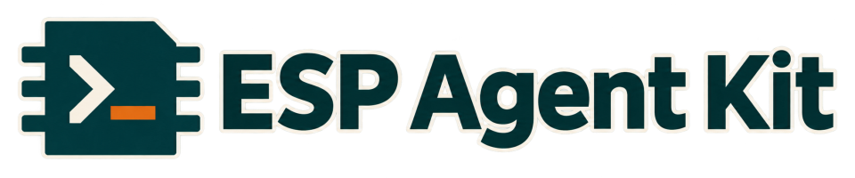
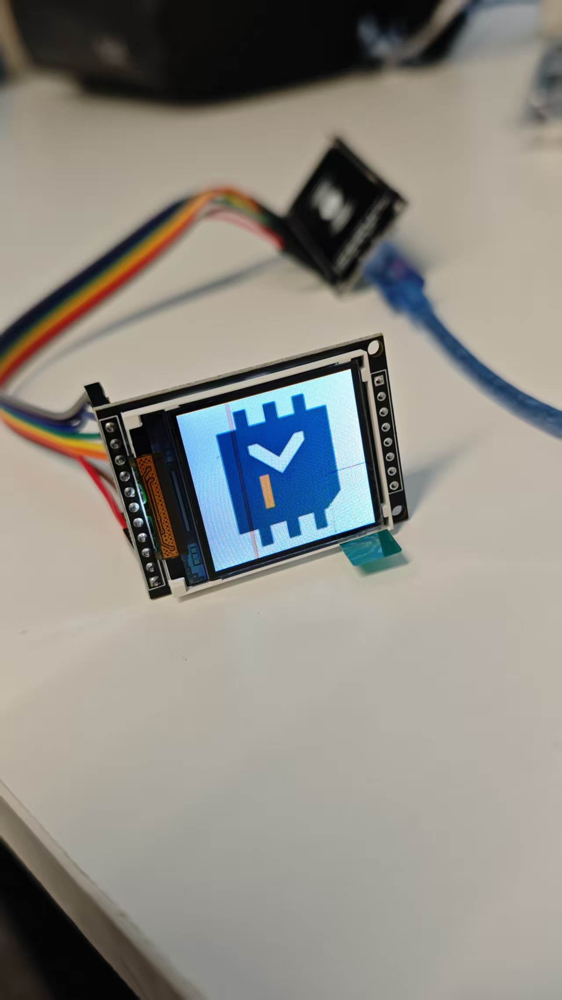
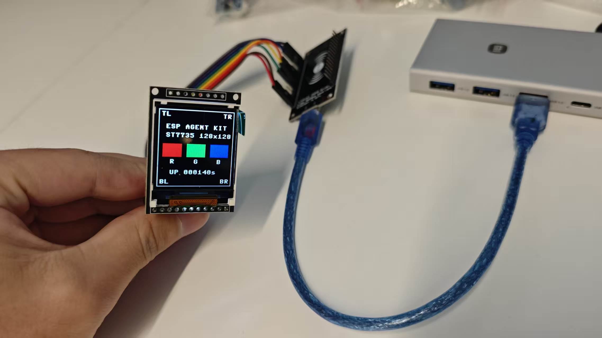

<h1 align="center"></h1>

<p align="center"><a href="README.md">English</a> · 简体中文</p>

<p align="center"><strong>通过自然对话，为硬件编程。</strong></p>

<p align="center">
  <a href="LICENSE"></a>
</p>

ESP Agent Kit 为你使用的桌面 AI Agent 提供设备识别、环境准备、编程、部署和实物调试所需的工具与指导。使用自然语言对话，按引导接线，再拿起设备试用。Agent 处理代码和工具命令，你通过反馈持续调整设备行为。

当前桌面目标为 macOS 和 Windows。Codex、Claude Code、WorkBuddy 等具备本地文件访问和命令执行能力的 Agent 可以使用同一套开发流程。当前开发聚焦于运行 MicroPython 的已适配 ESP 开发板，后续通过更多后端扩展硬件范围。

[快速开始](#快速开始) · [当前支持](#当前支持) · [路线图](#路线图)

<p align="center">
  
  
</p>

## 使用方式

连接硬件、描述目标，然后在试用中逐步调整行为。一个项目中的对话请求可以是：

> “有人靠近时，让灯亮起来。”
>
> “现在人离开灯就灭了，改成十秒后再灭。”
>
> “这个效果可以，保存这个版本。”

Agent 核对硬件与接线，编写应用并部署修改。你操作实物、描述实际现象，Agent 结合你的观察和板端反馈调整程序。确认行为符合预期后，它将源码和项目记录保存下来，供下次修改使用。

## 核心能力

| 能力 | 对你意味着什么 |
| --- | --- |
| **自然对话编程** | 描述希望实现的行为和修改，Agent 处理代码与底层工具。 |
| **从首次连接开始引导** | 让 Agent 准备环境、识别设备，指导接线并完成首次配置。 |
| **使用自己的 Agent** | 仓库中的 `AGENTS.md`、随附 Skill 和本地 CLI，为具备文件访问、命令执行能力的 Agent 提供共同流程。 |
| **开发与调试一体化** | 在同一流程中运行探针、查看异常、部署更新并从故障中恢复。 |
| **设备独立运行** | 安装后的应用随上电启动，脱离开发电脑和 Agent 会话运行。 |
| **项目可以继续开发** | 在本地保存源码、依赖、接线、部署快照和已确认的观察结果，方便后续修改或交接。 |

## 快速开始

将克隆后的 `esp-agentkit` 目录作为 Agent 工作区。根目录的 [AGENTS.md](AGENTS.md) 会在开发过程中引导 Agent 阅读和使用仓库随附的 [Skill](skill/esp-agentkit/SKILL.md)。所用 Agent 需要具备本地文件访问和命令执行权限。

### 1. 克隆并打开工作区

安装 Git 后执行：

```sh
git clone https://github.com/xucailiang/esp-agentkit.git
cd esp-agentkit
```

用 Agent 打开这个 `esp-agentkit` 目录。新的设备项目默认保存在 `device-projects/<项目名>/`，源码、接线说明、配置与开发记录放在一起。该目录已被仓库的 Git 配置忽略，保留成果或迁移项目时请单独备份。

### 2. 连接硬件，告诉 Agent 你的目标

使用 USB 数据线连接开发板，再将下面的提示词交给 Agent：

```text
请阅读 AGENTS.md，按其中的指引帮我开发，想实现：[描述功能]。
```

Agent 会根据你想实现的功能核对手上的板和实际接线。缺少信息时，它会说明要确认哪一处，并请你提供对应版本的引脚图、原理图或产品链接。手边没有图纸时，可以告诉它板上的型号、导线两端的标记，或在 Agent 支持图片时提供照片。核实的型号、资料来源和接线保存在当前设备项目，下次可以接着改。按引导完成首次配置和部署后，试用实物并描述希望调整的地方。交付前，给设备独立供电并确认实际行为。

Agent 使用 [设备检测](skill/esp-agentkit/SKILL.md#detect-a-connected-device)、[固件安装](skill/esp-agentkit/SKILL.md#install-the-firmware-on-a-new-board)、[首次配置](skill/esp-agentkit/SKILL.md#configure-and-verify) 和 [应用部署](skill/esp-agentkit/SKILL.md#deploy-an-application) 的详细指导执行操作。你随时可以让它解释实现原理，也可以直接修改代码。

### 3. 手动准备环境（可选）

环境准备可以交给 Agent。若希望自行执行，先在需要时安装 uv，按操作系统选择 [uv 官方安装指南](https://docs.astral.sh/uv/getting-started/installation/) 中的命令：

**macOS**

```sh
curl -LsSf https://astral.sh/uv/install.sh | sh
```

**Windows PowerShell**

```powershell
powershell -ExecutionPolicy ByPass -c "irm https://astral.sh/uv/install.ps1 | iex"
```

安装后重新打开终端，回到克隆的 `esp-agentkit` 根目录，再执行以下跨平台命令：

```sh
uv sync --project skill/esp-agentkit --locked
uv run --project skill/esp-agentkit --locked python --version
uv run --project skill/esp-agentkit --locked python skill/esp-agentkit/scripts/agentkit.py --help
```

uv 根据 Skill 中的 `.python-version` 选择 Python 3.12，创建 `skill/esp-agentkit/.venv`，并按 [uv.lock](skill/esp-agentkit/uv.lock) 锁定的版本安装 [pyproject.toml](skill/esp-agentkit/pyproject.toml) 中声明的依赖。`uv run` 会自动使用该环境，无需手动激活，工作目录仍为仓库根目录。预期看到 Python `3.12.x` 和 CLI 帮助信息；这些检查不会连接设备。

## 当前支持

项目正在持续开发。当前实现提供以下能力：

| 方面 | 当前范围 |
| --- | --- |
| 开发路径 | 与板型匹配的官方 MicroPython v1.29.0 固件，通过 USB 首次配置，随后在可信的 2.4 GHz Wi-Fi 局域网内使用 WebREPL 调试和更新应用。 |
| 桌面工具 | 使用 uv 管理 Python 3.12 环境，Skill 提供环境准备说明和本地 CLI。 |
| 芯片识别 | 发现 USB 串口，通过 esptool 识别所安装版本支持的乐鑫芯片。芯片识别不代表已确定载板引脚，也不代表首配和部署兼容性已经确认。 |
| USB 首配条件 | 4 MiB Flash 与 MicroPython v1.29.0，使用标准 `ESP8266_GENERIC` 或满足分区布局要求的经典 `ESP32_GENERIC` OTA 固件。详见[固件要求](skill/esp-agentkit/SKILL.md#install-the-firmware-on-a-new-board)。 |
| Agent 接口 | 需要本地文件访问和命令执行能力。Agent 阅读根目录 `AGENTS.md`，按随附 Skill 的指导在仓库工作区内调用 CLI。 |

已验证的开发板、操作系统与 Agent 组合统一见[验证记录](docs/roadmap.md#验证记录与待办)。

WebREPL 使用未加密连接，并与应用共用解释器；诊断命令可能中断正在运行的程序。Skill 会指导 Agent 按当前流程选择观察方式并恢复运行。

## 路线图

以下是建设方向，硬件适配和社区贡献可以按准备情况并行推进：

1. **打通 ESP 新手入口。** 串联环境准备、设备识别、首次配置、接线指导和首次部署，在不同桌面系统与 Agent 中提供一致体验。
2. **整合完整调试流程。** 连接串口输出、REPL、日志、探针、外设检查、故障恢复与跨会话续作。
3. **扩展原生编程与调试。** 接入工具链、固件构建、烧录，以及硬件支持的断点和变量观测。
4. **接入更多硬件家族。** 为其他 MCU 和 Linux 设备扩展识别、编程、观测与恢复后端。
5. **积累可复用的适配与项目。** 完善后端、驱动、应用模板、注明硬件条件的示例和故障处理资源的贡献方式。

完整说明见 [项目定位](docs/project-positioning.md) 和 [开发路线图](docs/roadmap.md)。规划能力与当前支持范围分别说明。

## 文档与贡献

- [Skill 与 CLI 指南](skill/esp-agentkit/SKILL.md)：配置、项目操作、调试、部署和恢复。
- [硬件与接线核对](skill/esp-agentkit/SKILL.md#check-the-board-and-wiring)：按当前功能确认硬件条件，将核实结果保存在设备项目中。
- [架构与实现说明](docs/architecture-and-development.md)：当前模块、运行机制与设计取舍。
- [项目开发约束](AGENTS.md) 与 [本地回归检查](tests/README.md)：贡献者参与项目的指导。

欢迎贡献硬件支持、驱动、文档和故障恢复改进。[提交问题](https://github.com/xucailiang/esp-agentkit/issues) 时，请附上开发板、固件、桌面操作系统、操作步骤与实际现象，分享日志前移除凭据。

[MIT 许可证](LICENSE) · [第三方许可](docs/third-party.md)
