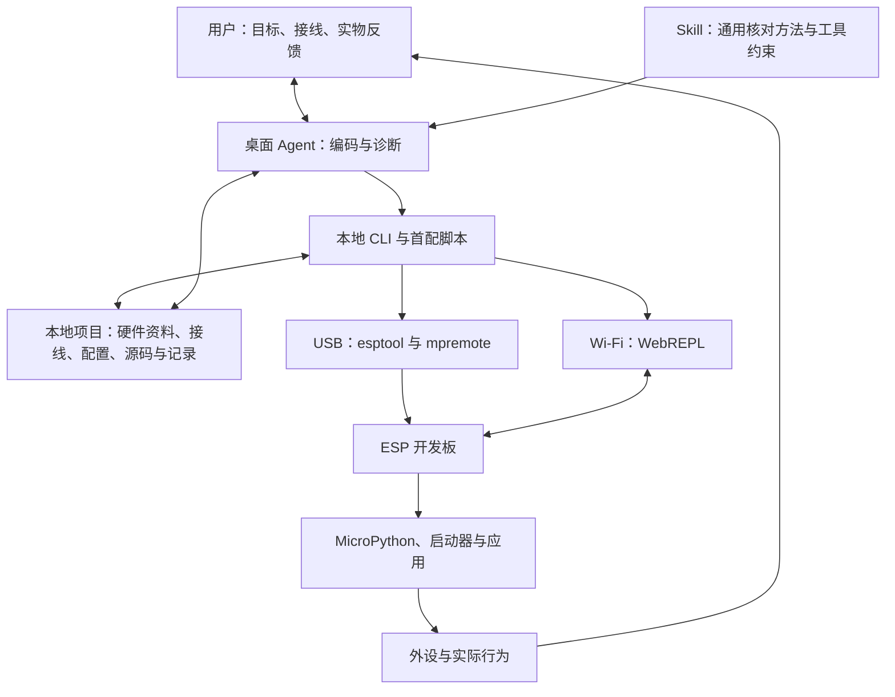

# ESP Agent Kit 架构与实现说明

本文面向维护者和接手开发的 Agent，说明当前代码如何协作、项目与设备状态如何关联，以及修改时需要保持的约束与设计取舍。未来各阶段的功能设计和完成状态统一维护在[开发路线图](roadmap.md)，具体操作步骤见 [Skill](../skill/esp-agentkit/SKILL.md)，产品目标见[项目定位](project-positioning.md)。

## 运行架构

当前板端运行普通 MicroPython 应用，项目不提供大模型或端侧推理框架。产品层的用户、Agent、工具与项目职责见[项目定位](project-positioning.md#3-核心功能与职责)。以下说明当前实现中的连接、数据和状态关系。

**连接和启动。** 首次通过 USB 写入 Wi-Fi 配置并设置独立的 WebREPL 密码。Agent 将核实后的设备 ID、地址和管理密码保存在设备项目的 `project.json` 中，管理密码使用明文。后续 CLI 从项目配置读取，或沿用显式参数和标准输入方式，通过可信局域网内的明文 WebSocket 直连开发板。配置与项目一起交接，不依赖操作系统凭据库或机器专属配置。密码不进入命令输出、部署回执、应用快照和公开版本库。平台维护两个启动文件。`boot.py` 初始化联网与管理入口，`main.py` 调用 `agentkit_runtime` 检查部署状态并进入用户应用。日常部署只需要用户应用的入口和依赖。[上游 WebREPL 说明](https://docs.micropython.org/en/v1.29.0/esp32/quickref.html#webrepl-web-browser-interactive-prompt) · [MicroPython 启动顺序](https://docs.micropython.org/en/v1.29.0/reference/reset_boot.html)

## 核心源码入口

| 职责 | 实现入口 |
| --- | --- |
| CLI 分派、目标选择、操作结果与重启流程 | [agentkit.py](../skill/esp-agentkit/scripts/agentkit.py) |
| 项目发现、配置校验与名称解析 | [projects.py](../skill/esp-agentkit/scripts/projects.py) |
| USB 首配、LAN 补存与本地项目创建 | [provision.py](../skill/esp-agentkit/scripts/provision.py)、[project_setup.py](../skill/esp-agentkit/scripts/project_setup.py) |
| 设备枚举、选择及 esptool 后端 | [detection.py](../skill/esp-agentkit/scripts/detection.py)、[detect_espressif.py](../skill/esp-agentkit/scripts/detect_espressif.py) |
| WebREPL 登录、raw REPL 与传输适配 | [webrepl_session.py](../skill/esp-agentkit/scripts/webrepl_session.py) |
| 文件清单、部署校验及已安装版本核对 | [deployment.py](../skill/esp-agentkit/scripts/deployment.py) |
| 源码快照、部署与重启回执、显式验收 | [project_records.py](../skill/esp-agentkit/scripts/project_records.py) |
| 板端联网、启动与异常保留 | [boot.py](../skill/esp-agentkit/board/boot.py)、[main.py](../skill/esp-agentkit/board/main.py)、[agentkit_runtime.py](../skill/esp-agentkit/board/agentkit_runtime.py) |

## 项目、版本与记录

Agent 根据当前功能确定需要核实的硬件信息，读取设备项目已有资料，并按缺口引导用户提供对应版本的原理图、引脚图、产品链接或实物照片。核实的板型、资料来源和实际接线随设备项目保存，续作时结合现场变化复核。公共 Skill 维护核对方法和工具条件，示例在自身文件中说明使用的引脚与电平。

项目发现由 `projects.py` 完成，搜索限制在当前 Git 工作区；没有上级 Git 工作区时使用当前目录，不依赖全局注册表。项目名称与别名采用精确匹配，也支持目录或配置文件路径；多个匹配时拒绝猜测目标。工作区操作方式见 [Skill](../skill/esp-agentkit/SKILL.md#work-with-a-project)。

项目根目录的 `project.json` 是唯一连接配置，包含 `name`、`app` 和 `device`，可选的 `schema_version` 默认为 1，`aliases` 和 `description` 用于查找与说明。其中 `device` 保存 `device_id`、`address` 和明文 `webrepl_password`，`app` 指向项目内独立的应用子目录。`provision.py --project-dir` 在设备验证后自动创建配置、应用入口和项目说明；设备配置成功但本地保存失败时，可用 `--save-project-only` 经 LAN 核对设备后补存，无需重复首配。已有项目保留原配置，也可由 Agent 按核实信息手工创建。目录可以连同源码、素材及记录复制给另一种 Agent。原有显式地址、设备 ID 和密码标准输入接口继续保留。[配置示例](../skill/esp-agentkit/examples/project.example.json)

项目中的设备 ID 是操作时的预期身份，地址是最近已知地址；历史 README 不能证明板上当前运行哪个版本。连接设备的项目命令检查设备 ID，`run` 在执行用户探针前完成核对。核对仍会中断前台解释器。地址变动时更新项目配置并重新确认目标，不自动通过 USB 读取信息或重配设备。同一设备的串口、REPL、探针和部署操作按顺序执行，部署时不并发打开串口监控。

项目部署先把应用固定为 `releases/<manifest>/` 快照，再从快照上传，并将结果写入 `records/`。提交、重启、重新登录与开发者验收分别记录；操作失败不等于板端一定未提交，无法确认时保留未知状态。开发者明确确认实物行为后，Agent 用 `accept --project NAME --manifest ID --observation TEXT` 保存本地验收记录，关联已有的部署回执和源码快照。该命令本身不测试设备。项目入口说明最近一次操作、已确认安装和已验收版本，注明时间及清单标识。

项目模式的 `restart` 先保存启动诊断，再请求复位；记录无法保存时拒绝复位。重启前后记录通过同一操作标识关联，不创建新的源码快照。对同设备、同清单已有的提交记录，成功重启可以补足其恢复证据，随后仍需用户明确观察才能 `accept`；重启本身不能独立产生部署或验收。

## 统一设备检测

`detect` 按三个步骤组织设备检测：发现可通信接口，选择工具与设备通信确认身份，再记录运行能力的检查结果。后端按协议和运行环境复用，不要求每款载板预先登记。USB 串口桥、实际芯片、载板型号和运行时分别记录，不能从 CH340、CP2102 等桥接芯片或通用固件名称推断载板型号。

本阶段枚举本地串口，并通过 esptool 的 ROM 协议探测乐鑫芯片。默认仅在存在唯一 USB 串口候选时主动探测；多个候选时返回接口信息，要求用 `--port PORT` 指定目标。`--list` 只枚举接口，不打开串口。没有 USB 元数据的本地串口也可显式指定。`--backend auto` 当前选择 esptool，也可用 `--backend esptool` 明确选择。探测默认限时 20 秒，可用 `--timeout SECONDS` 设置有限正数。

检测以 JSON 返回 `schema_version: 1`、接口、芯片与 Flash 信息，以及运行时和能力的检查状态。芯片身份已确认但 Flash 信息或复位请求未确认时保留探测结果并报告警告。载板保持未知；已安装固件、应用文件系统、网络和部署兼容性本阶段均标为 `not_checked`。ROM 探测不要求安装 MicroPython，也不替代现有首配中的固件检查。识别出其他 ESP 芯片或不同 Flash 容量，不表示现有首配和无线部署已适配该设备。探测所得 MAC 不能替代首配记录中的 MicroPython `device_id`。

主动探测会尝试进入下载模式，可能复位并中断当前程序；它不擦写 Flash，也不上传 flasher stub。已连接设备在结束时请求正常复位。超时、取消或复位结果未确认时，应释放 BOOT/FLASH 后手动复位。自动下载失败时，按实际硬件的下载模式操作重试。串口枚举和探测结果不会自动触发烧录。

实现上，[detection.py](../skill/esp-agentkit/scripts/detection.py) 负责接口清单、目标选择、结果封装与限时执行；[detect_espressif.py](../skill/esp-agentkit/scripts/detect_espressif.py) 负责 esptool 协议操作。后端在独立进程中返回 JSON，诊断写入标准错误。这样厂商工具的连接循环可以被超时终止，后续接入其他协议时复用同一入口及结果约定。

## CLI 操作与结果

| 操作 | 输入和结果 | 对设备的影响 |
| --- | --- | --- |
| `projects` | 列出当前工作区中的项目名称、别名和连接摘要，不输出密码 | 只读本地文件，不连接开发板。 |
| `detect` | 枚举本地串口，自动选择唯一 USB 候选或接受指定端口，通过 esptool 查询芯片与 Flash，返回未检查的运行能力 | 主动探测可能复位并中断当前程序，不擦写 Flash；`--list` 不打开端口。 |
| `info` | 按地址查询 MicroPython 版本、芯片信息、设备标识、部署状态、清单标识及本次开机异常 | 中断前台应用。适合配置和诊断场景。 |
| `run` | 传入短脚本，返回脚本输出，异常时保留板端 traceback | 占用前台解释器，不安装开机程序。探针对 GPIO 的写入会作用于实物。 |
| `put` | 上传单个驱动或模块到板上的试验目录，报告目标路径和传输结果 | 供后续 `run` 加载试验。上传本身不激活模块，不重启。 |
| `deploy` | 输入本地应用入口和完整依赖集合，报告安装结果和重启后的连接状态 | 中断当前应用，更新业务文件并触发正常启动。联网配置、管理密码和平台启动文件受保护。 |
| `restart` | 核对设备、启动器、已安装清单及实际文件，保留启动诊断，分别报告复位确认与管理重连结果 | 中断当前应用后复位，不部署本地源码；项目模式下诊断记录无法保存时拒绝复位。成功重连不代表应用已验收。 |
| `stop` | 中断当前前台程序，报告是否已返回 REPL | 已安装程序在下次正常启动时仍会运行。外设当前输出取决于应用的退出处理。 |
| `accept` | 按项目和清单标识保存开发者已确认的观察结果，检查对应部署记录及快照 | 仅写本地记录，不连接开发板或推断测试通过。 |

`run` 在标准输出返回探针输出，其余命令返回 JSON；板端 traceback 和 CLI 诊断写入标准错误。退出码与结果字段共同表达成功、错误或未知，自动化调用不能只凭收到输出就推断设备状态。项目命令读取所选项目的连接配置，独立调用保留显式参数、隐藏密码输入和 `--password-stdin`；`detect` 无需管理凭据。[调用方式、退出码与结果处理](../skill/esp-agentkit/SKILL.md#wireless-debugging)

USB 首刷使用 esptool，首配脚本通过 mpremote 安装启动文件和联网配置。无线会话用 `websockets` 建立连接，将 WebREPL 的文本帧适配为字节流，复用 mpremote 的 raw-paste 流控和输出解析。独立登录检查在认证后关闭连接。三个调试命令则在认证后中断前台程序，确认解释器响应，再返回操作结果。探针超时后，Agent 可以重新连接并用 `stop` 取回控制权。[无线会话实现](../skill/esp-agentkit/scripts/webrepl_session.py)

WebREPL 与应用共用一个前台 Python 解释器。要读取变量或运行探针时，CLI 必须说明是否中断了原程序。需要继续试用时，应恢复已安装应用的正常启动。验收连续运行的行为时，采用应用日志、外部测量或开发者观察，避免查询操作改变被测行为。

## 应用部署与中断恢复

首版采用**可重新部署的单份应用**。开发者项目中的一个独立目录保存 `app.py`、模块和所需数据文件。`deploy` 将板上专用的 `/agentkit_app` 与这个目录对齐。实测记录和需要跨版本保留的采样数据应放在发布目录之外。板上只需暂存正在传输的单个文件，文件内容未变化时沿用已校验的副本。这一设计适应 ESP8266 的存储条件，保证可核对状态并重装，不提供整包原子切换或自动回滚；中断更新可能暂停业务。[部署与恢复操作](../skill/esp-agentkit/SKILL.md#deploy-an-application)

1. **准备。** CLI 核对目标设备、文件清单、目标路径和可用空间。在 littlefs2 上，预估用量包含暂存文件和新增目录的元数据块。若写入时仍遇到空间不足，缩小应用或释放空间后重新部署。联网配置、平台启动文件和应用目录以外的路径不接受业务部署写入。`put` 的试验文件不隐式成为发布依赖。
2. **写入。** 开始改动业务文件前，先在板端持久记录「部署中」并确认写入成功。清理应用专用目录中本次清单以外的文件，包括之前更新中断时留下的文件。随后按依赖在前、业务入口在后的顺序逐个暂存、校验并替换有变动的文件。
3. **启动。** 全部文件核对完成后，提交本版清单，清除「部署中」标记，再触发与正常上电一致的重启。启动入口仅在清单已提交、可读且部署标记已清除时加载应用。首次空板、更新未结束或状态损坏时，均保留管理入口。CLI 在重启后限时尝试重新认证，这一步只报告管理连接是否恢复，不发送中断指令。
4. **修复。** 传输中断时，重新连接同一设备并从桌面重跑完整 `deploy`。若重启请求送达与否未知，报告「启动结果待确认」。此时 Agent 可以用 `info` 核对设备标识和部署状态，查询可能中断前台应用。部署标记已清除且已提交的清单与预期一致时，由 Agent 触发正常重启以恢复运行。仍在部署中、状态损坏或清单不符时，重装完整应用。应用主动关网时，改走 USB 串口中断应用并修复启动内容。

即使文件完整送达、管理连接恢复，用户应用也可能在导入驱动时抛出异常。启动入口捕获未处理的 Python 异常，把本次启动的清单标识和 traceback 的最后 2 KiB 留在内存中，然后返回 REPL。Agent 在再次重启前通过 `info` 读取错误，修正本地依赖并重新部署。这个记录只覆盖本次启动。突然掉电或整个解释器复位需另行复现。没有异常记录时，仍依照实际输入和外设动作判断应用行为。

标记写入、断线重连和文件替换的实板验证范围见[路线图中的验证记录](roadmap.md#验证记录与待办)。当前 USB 固件安装条件与步骤见 [Skill](../skill/esp-agentkit/SKILL.md#install-the-firmware-on-a-new-board)，实际设备的固件选择及依据随设备项目保存。

## 当前实现边界

检测层已有后端入口，目前实现 esptool；编程、部署和项目配置仍绑定 MicroPython、WebREPL 与 IPv4。不同后端的通用项目模型、原生构建和调试器尚未实现，功能设计见[路线图](roadmap.md#分阶段建设)。

WebREPL 使用明文连接，当前适用于可信局域网开发。部署入口保护联网配置和平台文件，不构成应用代码的沙箱；应用与探针拥有解释器权限。同设备顺序操作、接线事实维护和真实用户验收仍部分依赖 Agent 遵守 [Skill](../skill/esp-agentkit/SKILL.md) 与 [AGENTS.md](../AGENTS.md)，当前没有通用的跨进程设备会话锁。
