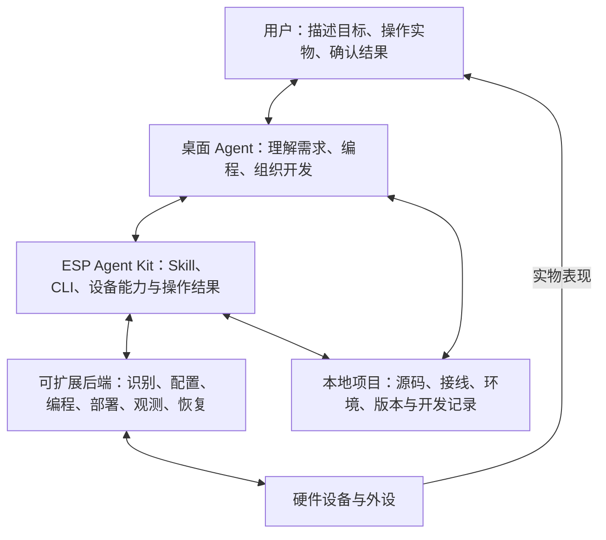

# ESP Agent Kit 项目定位与核心特性

> 插上硬件，通过自然对话完成编程、调试和交付，无需关注底层工具细节。

本文定义 ESP Agent Kit 的产品定位、目标体验、核心能力和用户流程。文中的能力描述是产品设计要求，不代表当前均已实现。[架构与实现说明](architecture-and-development.md)维护技术设计，[开发路线图](roadmap.md)维护建设计划、完成进度和验证范围，项目开发约束见 [AGENTS.md](../AGENTS.md)。

## 1. 项目定位与价值

**ESP Agent Kit 是跨操作系统、跨 Agent、可扩展到不同硬件平台的全流程硬件开发工具集，让用户从连接硬件、描述需求开始，由 Agent 完成环境准备、设备识别、编程、部署、调试和交付。**

项目从 ESP 系列切入，以统一的用户流程、可移植 Skill、本地 CLI 和开放项目文件连接桌面 Agent 与实体硬件。后续通过不同的识别、编程和调试后端接入更多硬件，用户继续沿用相同的开发方式。

**项目的核心目标之一是辅助开发者更方便、更快速地完成开发。** 围绕环境准备、代码修改、实物验证、故障恢复和后续维护，减少重复配置、工具切换和上下文整理。开发场景从简单原型到复杂嵌入式工程逐步覆盖，每次扩展都以具体场景能否顺利完成、是否减少开发负担为依据。

### 1.1 面向用户的承诺

用户买回硬件、接上 USB，把想实现的功能告诉自己使用的 Agent。Agent 配合 ESP Agent Kit 识别设备、准备环境、指导接线、编写程序并部署。用户拿着实物试用，用自然语言描述现象，Agent 据此诊断和修改，直到设备能够独立运行并满足用户要求。

用户无需预先掌握命令行、固件选择、编译工具链、文件传输协议或驱动编写方法。需要用户参与的接线、按键、供电和实物观察，由 Agent 给出具体步骤。用户保留目标选择、实物操作和结果判断，软件能够完成的技术操作由 Agent 与工具集承担。

对已有工程，Agent 从当前源码、配置和设备状态接手，按需要接入构建、部署、诊断或交接流程。熟练开发者可以保留原生工程格式、已有工具和手工操作方式；简单任务只使用所需能力，无需先配置复杂工程的全部工具。

### 1.2 在硬件开发生态中的位置

ESP Agent Kit 承接用户的功能意图和桌面 Agent 的规划能力，向下整合芯片工具、固件、驱动、连接协议和调试接口，将它们组织为可以连续执行的开发流程。

目标用户包括第一次接触开发板的新手、需要快速迭代的创客与原型开发者，以及希望复用开发流程的熟练工程师。产品以新手能够完成任务为默认体验，同时保留代码、日志和底层工具的访问方式。

### 1.3 核心价值

| 面向对象 | 项目提供的价值 |
| --- | --- |
| 用户 | 降低首次上手和持续开发的门槛，通过对话把想法变成实物行为，并在遇到问题时得到可执行的下一步。 |
| Agent 应用 | 复用统一的硬件操作接口、设备能力信息和结果约定，减少分别整合厂商工具与处理设备差异的工作。 |
| 硬件与工具生态 | 让已有芯片工具、固件、驱动和开发板通过一致的方式被 Agent 使用，适配成果可以跨项目、跨 Agent 复用。 |
| 项目维护者与接手者 | 从本地项目取得完整的开发成果和必要背景，在换电脑、换 Agent 或间隔一段时间后继续修改。 |

项目将设备核对、文件校验、状态记录和恢复操作固化为可重复执行的工具行为，让 Agent 能依据明确结果继续决策。每次完善的公共操作和适配能力，都可以服务后续设备项目。

## 2. 核心特性

### 2.1 自然对话编程，无需关注底层细节

用户以目标、行为和现象组织对话，例如“有人靠近就亮灯”“离开后再等十秒关闭”“现在一直闪，我希望只闪一次”。Agent 将这些表达整理为实现所需的条件，选择技术路径、生成代码、部署并解释结果。

交互围绕用户能理解的问题展开：设备应该做什么、目前发生了什么、还需要用户做什么。芯片参数、编译选项、串口名称和协议细节由工具与 Agent 处理；用户主动询问时，再展开原理和实现。只对影响实现或结果的歧义补问，不要求用户先写技术规格或手动编辑代码。

### 2.2 新手友好，低上手门槛与低开发门槛

产品流程从用户在所选 Agent 中打开克隆的 `esp-agentkit` 仓库、第一次连接硬件开始。根目录 `AGENTS.md` 引导 Agent 读取仓库内的 Skill，用户无需单独安装 Skill。Agent 检查本机环境，准备依赖和工具，发现设备，判断已有程序与运行环境，再安排后续操作。

Agent 尽量完成可自动执行的配置。需要接线、按键、输入凭据或系统授权时，提供明确且最少的操作步骤。安装失败、设备未出现、端口占用等问题也纳入引导流程，用户不必先学会排查底层工具。

低上手门槛覆盖首次连接和环境准备，低开发门槛覆盖需求表达、程序修改和反馈纠错。两者都延伸到故障恢复与后续维护。

### 2.3 跨 Windows、macOS 和 Linux

三个操作系统采用一致的项目格式、命令含义和用户流程。环境安装、设备访问、驱动提示、路径、编码和进程管理的系统差异由工具与对应的平台适配处理。

跨平台设计贯穿首次配置、日常开发、诊断、恢复和项目迁移。用户更换操作系统后，Agent 根据项目记录准备环境，核对设备及该系统上的后端可用性，再继续开发。实际验证过的系统、板型和流程组合以[验证记录](roadmap.md#验证记录与待办)为准。

### 2.4 跨 Agent 应用

以本地 CLI、开放项目文件和可移植 Skill 作为共同接口，面向 Codex、Claude Code、WorkBuddy 等具备文件访问和本地工具调用能力的 Agent 应用。各应用在同一仓库工作区中，根据 `AGENTS.md` 读取 Skill 并调用同一套 CLI；不能自动加载入口说明的应用，由首次对话明确要求读取。

兼容范围由所需能力决定，不以特定 Agent 品牌为前提。专属插件可以作为便利入口，基础开发流程保持独立可用。所选 Agent 的权限和能力不足时，提供具体的设置说明或可用的替代路径。

### 2.5 硬件无关的流程与可查询的设备能力

用户流程、项目结构和操作结果保持统一。芯片协议、固件、编程语言、连接方式和调试方法由后端处理，Agent 根据目标设备的能力选择合适路径。

ESP 阶段以 esptool 为芯片识别后端，目标是覆盖所采用 esptool 版本支持的 ESP 系列芯片，并随上游能力扩展。后端按协议和运行环境复用，自动识别不要求每款载板预先登记。

设备信息分别记录可通信接口、芯片身份、Flash 等资源、载板与接线、运行环境、连接方式及调试能力，并标明哪些信息已确认、哪些仍未知。识别出芯片后，继续判断相应的编程与运行路径；载板引脚和实际外设连接通过资料与用户输入补充。

MicroPython、原生编译程序以及未来其他运行环境，都属于具体实现选择。USB、Wi-Fi、调试器等连接方式同样按硬件能力使用。接入新硬件时，用户仍可以通过自然对话完成开发。

### 2.6 全链路工具集成与对话式调试

整合环境准备、设备发现、固件配置、驱动与业务编程、构建、烧录、应用更新、运行控制、观测和恢复。Agent 根据设备状态选择工具，并将上一步的结果用于下一步操作。

调试综合串口输出、运行日志、Python 异常或原生程序诊断、短探针、外设读数与用户观察。在硬件和后端支持时，进一步接入断点、变量观测等调试能力。Agent 将“设备表现不对”的反馈转成可执行的排查步骤，区分环境、连接、接线、驱动与应用逻辑问题。

工具需要表达操作结果、对设备的影响和仍待确认的状态。同一设备的会话统一协调，避免烧录、监控、探针和复位互相干扰。观测可能中断应用时，Agent 调整观察方式，并在需要时恢复应用运行。

### 2.7 自然的实物信息输入

用户可以提供文字描述、板子与接线照片、商品链接、原理图、数据手册和试用现象。Agent 从中逐步整理型号、引脚、电平、极性、总线地址和实际连接，用户无需预先制作完整的专业资料。

图片理解和网页读取利用所选 Agent 可用的能力，同时保留文字描述与人工观察路径。存在歧义时，Agent 给出具体的确认动作，例如查看板背型号或指出某根线的连接位置。硬件事实保留来源和确认状态，后续修改沿用已核实的信息。

### 2.8 跨会话、跨电脑、跨 Agent 连续开发

项目保存需求、接线、设备身份、源码版本、最近操作、已确认行为和未解决问题。操作与实物观察记录注明时间，并关联对应的源码版本和部署清单。关闭聊天、中途断线或更换 Agent 后，新的会话可以根据这些资料继续推进。

接手时重新核对当前设备与安装状态，区分历史记录和现场情况。人工修改的源码和配置也要重新读取，开发进度始终以项目和当前设备为依据。

### 2.9 可控、可解释、可恢复的自动化

Agent 在已有授权范围内自动推进常规工作，向用户说明关键进展和必要判断。覆盖已有固件、删除数据等动作需要明确操作范围和影响，沿用已有授权，缺少授权时再请求确认。

用户能够暂停开发、查看当前状态或接管操作。遇到环境安装失败、连接中断、传输不完整、启动异常等情况，工具保留足够的状态，支持诊断、重试和继续执行。

恢复可以采用重新连接、重新部署已有版本或对应硬件的恢复方式，具体取决于后端能力。需要用户重新插线、复位或使用 USB 时，Agent 给出明确步骤。恢复过程应说明应用是否暂停、数据是否受到影响，以及哪些结果尚未确认。

### 2.10 本地资产与可重建的开发环境

项目目录保存源码、资源、依赖版本、固件信息、工具链或运行环境说明、实际接线、部署快照和开发记录，作为可迁移的交接单元。Agent 在新电脑上根据这些资料重建环境，并核对实际设备。

设备项目默认保存在仓库内的 `device-projects/<project-name>/`，与共享工具和 Skill 分开。该目录由仓库忽略规则排除，用户需要保留和单独备份；换电脑或 Agent 时，在目标仓库中恢复完整设备项目后继续开发。

用户拥有并能够导出、修改和继续维护开发成果。项目的连接配置受控保存，凭据不进入公开源码、通用模板或操作日志。分享可复用资源时，只包含适合公开的项目内容。

设备交付后自行启动和执行应用，不要求开发电脑或 Agent 会话保持在线。设备业务自身需要的网络服务由具体需求决定，所选 Agent 也可以使用云端或本地模型。

### 2.11 随用户成长的体验与可复用方案

新手主要看到目标、当前进展和必要操作；熟练用户可以查看完整日志、修改源码、选择工具和接管调试。同一项目支持不同深度的参与，用户无需因为能力提升而重新迁移开发成果。

驱动、应用模板、接线方案和故障处理经验逐步沉淀为可复用资源。每份资源说明适用硬件、依赖和使用条件，Agent 根据当前设备选择、组合并调整。社区可以贡献后端、板型资料、驱动和方案，使新增能力进入已有开发流程。

## 3. 核心功能与职责

| 功能组 | 核心职责 | 用户得到的结果 |
| --- | --- | --- |
| 环境与设备接入 | 准备工具、发现接口、核对设备身份、判断现有环境与可用能力。 | 接上硬件后知道设备是否可用，以及下一步需要做什么。 |
| 需求与接线引导 | 整理行为要求、理解硬件资料、指导接线、补齐必要信息。 | 从想法逐步得到可实现的设备行为与接线方案。 |
| 编程与依赖管理 | 选择运行方式，准备固件、驱动、业务代码、资源与构建环境。 | 无需手工组织底层工具即可完成程序开发。 |
| 部署与运行控制 | 核对目标，烧录或更新应用，校验文件，启动、停止和重启。 | 修改能够作用于正确设备，并有明确的操作结果。 |
| 观测、诊断与恢复 | 汇集软件与实物反馈，安排探针和调试，判断故障并恢复。 | 遇到问题后仍能继续开发，减少自行研究工具报错的负担。 |
| 项目保存与交接 | 维护源码、环境、接线、版本、操作记录和用户确认结果。 | 设备可独立使用，项目可再次开发和移交。 |

Agent 负责理解需求、选择操作、编写代码、解释结果并与用户协作。仓库根目录 `AGENTS.md` 引导 Agent 按开发阶段查看 Skill，Skill 说明如何组织这些工作。CLI 和后端负责可重复执行的操作、状态约束和结果返回。设备能力与板型资料帮助 Agent 判断哪些操作可用，项目目录承载跨会话的开发成果。

后端分别承担识别、配置、编程、运行、观测和恢复能力。新增后端声明自己提供的能力以及操作影响，复用共同的身份、状态与结果约定；板型和接线资料描述具体硬件差异。现有厂商工具和上游运行环境作为可整合的基础能力使用。

## 4. 用户流程

**连接硬件 → 描述想法 → 引导接线与准备 → 编程部署 → 实物试用 → 对话纠错 → 独立运行 → 随时继续修改。**

首次开发沿用这条完整流程。已有项目的入口也可以是一次功能修改、现场故障或交接请求；Agent 先读取项目并核对现场，再进入所需阶段，避免重复首配或无关操作。

| 阶段 | 用户参与 | Agent 与工具集承担的工作 |
| --- | --- | --- |
| 1. 开始使用 | 用所选 Agent 打开克隆的 ESP Agent Kit 仓库，把硬件接上 USB。 | 读取根目录 `AGENTS.md` 及其引用的 Skill，检查访问能力，准备本机环境，发现设备；必要时引导用户完成系统授权或物理操作。 |
| 2. 识别与理解设备 | 有多个目标或信息不明时，按提示选择设备、提供型号或照片。 | 核对芯片与设备身份，判断已有固件、资源和运行能力，确定可采用的开发路径。 |
| 3. 描述目标 | 用自然语言说明想实现的功能、使用方式和已有材料。 | 把需求整理为初始状态、操作或输入、预期行为及观察方式，只补问影响实现的问题。 |
| 4. 准备硬件与运行环境 | 按步骤接线、供电，提供必要凭据或确认已有内容的处理方式。 | 查阅资料、核对引脚与电气条件，选择并配置运行环境，建立项目和连接信息。 |
| 5. 编程与部署 | 根据需要确认具体行为选择。 | 编写或复用驱动与应用，处理依赖和资源，构建或上传到目标设备，并启动程序。 |
| 6. 试用与纠错 | 操作实物，描述实际现象与期望的差异。 | 对照代码、日志、读数和观察结果排查问题，修正软件或指导调整接线，再部署并安排复试。 |
| 7. 独立使用与交付 | 脱离开发电脑重新上电，实际使用并确认结果。 | 检查开机执行与必要配置，保存对应源码、依赖、接线和用户确认的行为。 |
| 8. 后续修改与交接 | 提出新需求，可以更换电脑或 Agent。 | 读取项目、重建所需环境、核对当前设备状态，从已有版本继续修改并检查受影响的行为。 |

### 4.1 故障与中断时如何继续

- **没有发现设备：** 检查线缆、接口、驱动和权限，明确指出需要用户执行的步骤。
- **硬件或接线信息不完整：** 利用已有资料和设备读数缩小范围，再请求具体的型号、照片或观察结果。
- **已有程序或数据需要保留：** 先确认操作范围，按后端能力安排保留、备份或恢复路径，再执行写入。
- **程序未启动或实物行为不符：** 结合异常、日志、探针和用户观察定位问题，选择不会破坏当前观察条件的方法。
- **连接或部署中断：** 核对实际状态，明确已完成与未确认的步骤，从可继续的位置重试；需要时重新部署完整版本。
- **开发暂时停止或交给另一种 Agent：** 保存最近状态和未解决问题，下次接手先核对现场，再继续工作。

技术操作完成、管理连接恢复、应用启动和用户确认行为分别记录。用户看到清晰的进展，Agent 获得足够精确的信息来决定下一步。
